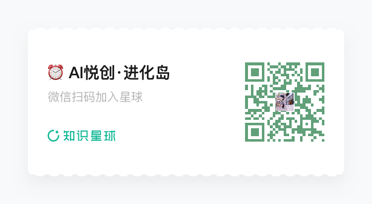

你好，我是悦创。

我需要很多邮箱，需要拿去注册 muse，白嫖额度！

虽然现在 muse 垃圾，但是 token 多肯定比没有好！

## 1. 背景

当团队需要一个挂着项目域名的邮箱（用来注册海外平台、接收用户反馈、对外展示联系方式），但又不需要主动发信时，完全没必要花钱买企业邮箱。

Cloudflare Email Routing 是目前最轻量的方案：

- **完全免费**，没有容量和条数限制；
- 配置只需几分钟，不需要维护任何邮箱后台；
- 将发送到 `admin@yourdomain.com` 的邮件**无缝转发**到你的私人邮箱（Gmail、QQ、Outlook 等）。

核心原理很简单：你的域名作为"门面"，Cloudflare 在收到邮件后瞬间转发到你指定的目标邮箱，你在自己熟悉的邮箱里就能收到所有邮件。

## 2. 准备工作

- 一个你自己的域名（假设为 `yourdomain.com`）
- 一个 Cloudflare 账号（[免费注册](https://dash.cloudflare.com/sign-up)）
- 一个私人邮箱用于接收转发邮件（推荐 Gmail 或 Outlook）

## 3. 配置步骤

### 3.1 第一步：将域名托管到 Cloudflare

如果你的域名已经在 Cloudflare 解析，直接跳到第二步。

1. 登录 [Cloudflare 控制台](https://dash.cloudflare.com/)，点击 **“添加站点 (Add a Site)”**，输入域名。
2. 选择 **Free** 计划。
3. Cloudflare 会自动扫描现有【DNS 记录】，确认无误后继续。
4. 系统分配两个 **Nameservers**（如 `kara.ns.cloudflare.com`），你需要到域名注册商（阿里云、腾讯云、Namecheap 等）把原来的 NS 记录替换为 Cloudflare 提供的这两个。
5. 等待站点状态变为 **Active**（通常几分钟到几小时）。

### 3.2 第二步：开启 Email Routing

1. 在 dashboard 点击"**域名**"-“**概览**”，再点击你的域名进入域名管理页面，左侧菜单找到 **“电子邮件 (Email)” → “电子邮件路由 (Email Routing)”**。

2. 点击 **“开始使用 (Get Started)”**。

    

3. 点击接入域名：

    

4. 点击继续：

    

5. 点击**激活**：

    


### 3.3 第三步：创建路由规则

1. 切换到 **“路由规则 (Routing rules)”** 选项卡，点击 **“创建路由规则”**。

    

    

    ::: details 详细解释

    这是 **Cloudflare 的邮件路由规则**，用来设置：**别人发到你的 `某个名称@brclio.com` 的邮件，应该转发到哪里，或怎样处理。**

    #### 1. 电子邮件匹配模式

    这里用于指定**要处理的收件地址**。左边填邮箱前缀，右边选择域名。

    | 左侧输入框 | 右侧域名     | 这条规则处理的收件地址 |
    | ---------- | ------------ | ---------------------- |
    | `hello`    | `brclio.com` | `hello@brclio.com`     |
    | `admin`    | `brclio.com` | `admin@brclio.com`     |
    | `support`  | `brclio.com` | `support@brclio.com`   |

    例如填写 `hello`，就是设置**别人发给 `hello@brclio.com` 的邮件如何处理**。匹配依据是收件人地址。

    #### 2. 发送到电子邮件

    作用：把收到的邮件，转发到你已有的邮箱。

    例如你这样配置：

    | 配置项           | 示例                                    |
    | ---------------- | --------------------------------------- |
    | 电子邮件匹配模式 | `hello@brclio.com`                      |
    | 操作             | 发送到电子邮件                          |
    | 目标邮箱         | 你已有的 QQ 邮箱、Gmail 或 Outlook 邮箱 |

    之后别人给 `hello@brclio.com` 发邮件，你就到所指定的目标邮箱里查看。

    **目标邮箱需要先验证。** Cloudflare 会给它发一封验证邮件，你打开邮件完成验证后，对应的转发规则才能正常启用。

    **适合：** 想对外使用自己的域名邮箱地址，同时继续在熟悉的邮箱中收信。

    #### 3. 发送到 Worker

    **作用：把收到的邮件交给一个运行在 Cloudflare 上的程序，由程序决定怎样处理。**

    这里的 **Worker** 可以理解为你部署在 Cloudflare 上的一段代码。用于接收邮件的 Worker 需要包含邮件处理函数 `email()`，可以通过代码实现：

    - 根据发件人或其他条件，决定是否转发。
    - 读取邮件内容，进行解析或分类。
    - 按规则自动回复收到的邮件。
    - 拒收不符合条件的邮件。
    - 配合存储服务保存邮件，或将邮件转成客服工单。

    例如，你可以让发到 `support@brclio.com` 的邮件交给 Worker，程序提取邮件内容、创建工单，然后把邮件转发给客服。

    **实际会做哪些事情，取决于 Worker 的代码。** 保存邮件、转发邮件和生成收件箱界面，都需要相应程序支持。

    **适合：** 自建邮箱项目、邮件自动处理、客服工单系统，或者需要邮件接入自己的网站和应用。

    #### 4. 丢弃

    **作用：收到符合这条规则的邮件后，直接静默丢弃。**

    例如：

    | 配置项           | 示例             |
    | ---------------- | ---------------- |
    | 电子邮件匹配模式 | `old@brclio.com` |
    | 操作             | 丢弃             |

    以后发到 `old@brclio.com`、并进入这条规则处理的邮件，就不会转发到你的邮箱。

    这里的“静默”表示：**执行丢弃这个动作本身，不会向发件人发送退信通知。

    **适合：** 某个地址已经不用了，或者你明确希望忽略发给这个地址的所有邮件。

    #### 5. 总结

    你可以这样选：

    | 你的需求                                                    | 选择               |
    | ----------------------------------------------------------- | ------------------ |
    | 用 `hello@brclio.com` 收邮件，在 QQ／Gmail 等现有邮箱里查看 | **发送到电子邮件** |
    | 接入自己部署的邮箱项目，或用代码处理邮件                    | **发送到 Worker**  |
    | 忽略发给某个地址的所有邮件                                  | **丢弃**           |

    :::

2. **匹配模式**：输入你想要的前缀，比如 `admin`、`team`、`support`。

3. **操作**：选择 **“发送到电子邮箱”**。

4. **目标地址**：选择上一步验证过的私人邮箱。

5. 保存。

### 3.4 匹配所有邮箱「可选」


下面这个步骤，需要你提前添加：**目标地址**。


### 3.5 第四步：添加目标邮箱

1. 在 **“目标地址 (Destination address)”** 中输入你的私人邮箱（如 `your_name@gmail.com`）。
2. Cloudflare 会发送一封验证邮件到该地址。
3. 打开私人邮箱，点击邮件中的 **“Verify email address”** 完成验证。


### 3.6 第五步：测试

用一个**无关的第三方邮箱**（比如同事的邮箱或你的备用邮箱），给 `admin@yourdomain.com` 发一封测试邮件，确认你的私人邮箱能正常收到。


## 4. 进阶：Email Worker 实现一对多转发

Cloudflare 的路由规则有一个限制：**一个自定义地址只能指向一个目标邮箱**。如果你想让 `team@yourdomain.com` 同时转发给多位团队成员，需要用 Email Worker。

### 4.1 验证所有目标邮箱

在 **Email Routing → 目标地址** 中，把团队所有成员的私人邮箱都添加并完成验证。Cloudflare 规定 Worker 只能将邮件转发给已验证的地址。

### 4.2 创建 Email Worker

1. 左侧导航找到 **“Workers 和 Pages”**，点击 **“创建应用程序”**，“从Hello World开始”。
2. 起个名字（如 `team-email-forwarder`），点击部署。
3. 点击 **“编辑代码”**，替换为以下内容：

```bash
export default {
  async email(message, env, ctx) {
    const forwardList = [
      "memberA@gmail.com",
      "memberB@qq.com",
      "memberC@outlook.com",
    ];

    await Promise.all(forwardList.map((address) => message.forward(address)));
  },
};
```

保存并部署。

### 4.3 绑定 Worker 到路由规则

1. 回到 **Email Routing → 路由规则**。
2. 编辑或新建 `team@yourdomain.com` 的规则。
3. **操作**选择 **“发送到 Worker (Send to a Worker)”**。
4. 目标选择刚刚创建的 `team-email-forwarder`。
5. 保存。

现在任何人给 `team@yourdomain.com` 发邮件，所有团队成员都会同时收到。

## 5. 避坑指南

### 5.1 不能用域名邮箱发信

Cloudflare Email Routing 只提供**收信转发**，不提供 SMTP 发信服务。如果需要以 `admin@yourdomain.com` 的身份发信，可以：

- 使用 Gmail 的「用其他地址发送邮件 (Send mail as)」功能
- 搭配免费的第三方 SMTP 服务（如 Brevo、Resend 的免费额度）

### 5.2 隐私和安全

Cloudflare 的隐私政策明确：Email Routing 只在内存中处理转发，不会将邮件内容存储到磁盘。作为全球最大的网络基础设施商之一，安全性是有保障的。

### 5.3 Catch-All 规则

如果你想接收所有发到你域名的邮件（不管前缀是什么），可以开启 **Catch-All** 规则，将任意 `*@yourdomain.com` 统一转发到一个目标邮箱。这在注册各种平台时特别方便，可以随手用 `github@yourdomain.com`、`vercel@yourdomain.com` 等任意地址注册。


## 7. 总结

| 需求                  | 方案                             |
| --------------------- | -------------------------------- |
| 只收不发，1 对 1 转发 | Email Routing 路由规则           |
| 只收不发，1 对多转发  | Email Worker                     |
| 需要发信              | 搭配 Gmail Send As + 第三方 SMTP |

对于大多数独立开发者和小团队来说，Cloudflare Email Routing 完全够用。零成本、零维护、配置简单，是域名邮箱的最佳起点。

::: details 公众号：AI悦创【二维码】


:::

::: info AI悦创·编程一对一

AI悦创·推出辅导班啦，包括「Python 语言辅导班、C++ 辅导班、java 辅导班、算法/数据结构辅导班、少儿编程、pygame 游戏开发、Web、Linux」，招收学员面向国内外，国外占 80%。全部都是一对一教学：一对一辅导 + 一对一答疑 + 布置作业 + 项目实践等。当然，还有线下线上摄影课程、Photoshop、Premiere 一对一教学、QQ、微信在线，随时响应！微信：Jiabcdefh

C++ 信息奥赛题解，长期更新！长期招收一对一中小学信息奥赛集训，莆田、厦门地区有机会线下上门，其他地区线上。微信：Jiabcdefh

方法一：[QQ](http://wpa.qq.com/msgrd?v=3&uin=1432803776&site=qq&menu=yes)

方法二：微信：Jiabcdefh

:::

