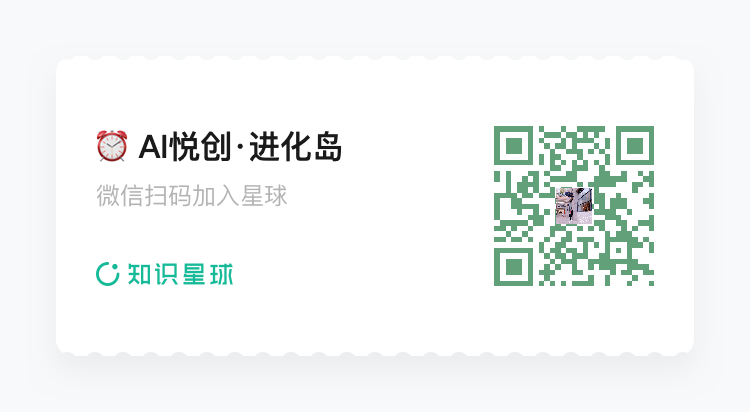

你好，我是 Brclio。

之前在视频号发布了，海外 GG 卡注册教程。没想到，爆火了！

很多人都实操，成功了！——不过，后面因为是线上、虚拟卡等各种原因，GG 卡实施了大规模的封号。

## 1. 为什么选择「新西兰🇳🇿实体手机卡」

### 1.1 原因一：OpenAI 不允许换绑

OpenAI 不允许绑定的手机号，后期修改。并且，不知道后期会不会开始：仅限手机号登录。

官方链接说明：

- [https://help.openai.com/zh-hans-cn/articles/9135134-how-to-change-the-phone-number-associated-with-your-account](https://help.openai.com/zh-hans-cn/articles/9135134-how-to-change-the-phone-number-associated-with-your-account)
- [https://help.openai.com/zh-hans-cn/articles/10388702-phone-only-signups](https://help.openai.com/zh-hans-cn/articles/10388702-phone-only-signups)

### 1.2 原因二：折腾半天有可能被封

- **群友官方邮件**：

- **谷歌查询**：

- **粉丝群里实际截图：**

::: tabs

@tab iamge1

@tab image2

@tab image3

@tab image4

@tab image5

@tab image6

@tab image7

@tab image8

@tab image9

@tab image10

:::

所以，折腾半天还有被封号的可能。还是选择直接卖吧～

### 1.3 原因三：真实客户的需求&面临的情况

你去市面上的店去买，大部分是没有我这得天独厚的条件。我的朋友是定居新西兰的，并且也是和我一致想做这个业务。

对于，大部分人来说：自己操作办理一张卡，还是有难度的。

### 1.4 原因四：为什么要做？源于一段对话

- 现在新账号用 Codex 都要用手机号。
- 一开始的想法：就是不做假手机卡，这个卡可以邮寄，但是运费客户出，用户也可以不出，收日常管理费和维护的一点话费，用的时候提前联系，你插卡然后收验证码。（最后得出：直接卖卡方便，用户自己养号）
- 得天独厚的匿名开卡。

### 1.5 原因五：自己折腾的钱和买一张差不多

为什么要买，前后折腾要花的钱【一百来块】，直接买只需要：【125 元】。主打：省心！

## 2. 新西兰卡的费用&购买方式

## 2.0 两种卡的区别

One.nz 和 Spark 的区别就是：中国移动和中国联通这样的区别，不过实际测试下来：

- One.nz：插卡、获取国内信号稍慢，网络 4G、5G 切换；
- Spark：插卡，秒入国内网，稳定 5G；（我个人喜欢大牌）

**以上结论，均要结合自己实际情况！仅供参考！**

### 2.1 One.nz

125 元，再无其它额外的费用。

付款方式：先付款 120¥，等卡从新西兰寄到国内，到我手里。———> 我再联系你们进行 Codex 激活，确保手机卡可用———>微信小店下单 5¥。（为了走微信小店的物流，便于查询）

直接微信、支付宝转账付款即可。

缺点：国内信号接入慢一点，就是插卡到有信号📶会慢一些，信号稍弱。但不影响使用！

### 2.2 Spark 最大牌卡（推荐）

185 元，再无其它额外的费用。

付款方式：先付款 180¥，等卡从新西兰寄到国内，到我手里。———> 我再联系你们进行 Codex 激活，确保手机卡可用———>微信小店下单 5¥。（为了走微信小店的物流，便于查询）

### 2.3 优质号码

这个就是所谓的靓号的意思，如果想要长期养号一个优质号码。

- one.nz：在上面的基础上+20，也就是 125+20=145 元；
- Spark：在上面的基础上+20，也就是 185+20=205 元；

## 3. 交易总流程

微信、支付宝付款———>手机卡到我手里，联系激活 Codex———>微信小店下单———>寄出快递———>自行使用。

**欢迎推荐给你的好友们，让大家一起降低门槛使用海外 AI。当然，有出国旅游的，也可以进行购买。**

购买的，不要着急，耐心等待。真实国际物流，海关、新西兰工作效率较慢。我会按顺序联系你们！

不论你们用手机号做什么，我会在邮寄给你们之前，会先帮助你们进行手机号验证 Codex，保证验证通过且手机卡正常。

所以，你们需要提前准备一个谷歌账号。（网页版注册、手机 Gamil 注册，都试一试，因为有时候谷歌风控，不好注册。）

然后用谷歌账号注册 ChatGPT，安装客户端 Codex。提示手机验证，就可以正式开始。

需要 🪜，大家应该都有。如果没有，我新书《编程启蒙：思维与代码》北航出版，购书➕好评。福利：一年🪜。

各自做好准备。

## 4. 快递多久到？

首先，先从新西兰邮寄到国内，需要：1～3 周。（经过实测发现，主要占用最多的时间有三：新西兰工作效率、北京海关、福建海关）

## 5. 为什么选择我们？

### 5.1 合规、合法

合规、合法！正规途径！（国际物流、走海关！海关可过，代表一切！）

### 5.2 真实国际物流

从下面图片中，你也能知道需要多久物流了。真实所需的物流时间！

- **www.nzpost.co.nz**：

- **邮政 EMS 也可查询**：

 

 

 

## 6. 你为什么需要长期养一个手机号？

未来，国外的 AI 产品只会越来越多。不知道，封锁如何，在国内的我们如果想要使用国外的产品，拥有一个海外手机号还是必要的。特别是对于我们这种，没条件出国的人。

不少，新产品大部分都要验证手机号，这不是使用🪜可以解决、办理的。

## 7. 为什么是新西兰，而不是其它国家？

1. 为什么是新西兰，我朋友刚刚好在新西兰；
2. 新西兰支持匿名办理手机卡；
3. 国内合规（能过海关就是最好的证明）；
4. 新西兰是老美的狗腿子。

## 8. 实测结论（不定期增加）

1. 实测：一张手机卡支持激活两个 Codex 账号，中间间隔 1 周。（实际你们可以自行测试）建议：最好用在自己的账号，不要借此共享。（此结论，未经过批量测试，实际不支持也不要死磕）
2. 待增加；

## 9. 手机卡百问（不定期更新）

### 9.1 每年养号如何养？

每年充值 5 美元即可，目前政策无需消费。

**收到之后，请尽快充值！**

**收到之后，请尽快充值！**

**收到之后，请尽快充值！**

- 政策链接：[https://one.nz/faq/when-does-prepay-credit-expire?utm_source=chatgpt.com](https://one.nz/faq/when-does-prepay-credit-expire?utm_source=chatgpt.com)

 
### 9.2 短信一条短信多少钱？

参考：漫游大概 4rmb 一条，按实际情况即可。

收短信不要钱！

### 9.3 卡是什么类型？

就是正常国内的手机卡，可以直接插卡。不是虚拟的 esim 卡，如果需要可以特殊申请办理。（价格看实际情况）

### 9.4 如何交易？

直接微信、支付宝，皆可！

### 9.5 这个卡会不会被封卡呀？经常在国内用

目前不会，目前政策是支持长期海外使用，不过实际看情况，都属于不可抗力！

### 9.6 这个卡在国外已经激活了，邮箱什么的，我回来什么都能改吗？

我们只负责：购买卡、激活卡，其它都是交给你们自己操作。没有什么绑定邮箱，那些复杂流程。

和你在国内办理手机卡一样（你在国内办理手机卡，要绑定邮箱？显然不用。），就是一张卡，其它自己操作。

### 9.7 这个卡也不敢说能用多长时间是吧?会不会在国内取消是吧？

新西兰不会封，主要看国内。国内政府要来封卡，谁都管不了，只要别做违法的事情，一般也不会被封。

当然，如果新西兰政策改变的话，那也没办法～

## 10. 售后问题

质保半年，这玩意都是看政策走的。半年内，出现问题。经过验证、运营商查询后，我们会联系当地运营商进行注销或者补办一张卡。不过，就不再邮寄。

如果需要邮寄，实际邮费多少就付多少，我们不再赚钱。

每位顾客，仅限售后一次！

## 10. 充值教程

::: details 公众号：AI悦创【二维码】

:::

::: info AI悦创·编程一对一

AI悦创·推出辅导班啦，包括「Python 语言辅导班、C++ 辅导班、java 辅导班、算法/数据结构辅导班、少儿编程、pygame 游戏开发、Web、Linux」，招收学员面向国内外，国外占 80%。全部都是一对一教学：一对一辅导 + 一对一答疑 + 布置作业 + 项目实践等。当然，还有线下线上摄影课程、Photoshop、Premiere 一对一教学、QQ、微信在线，随时响应！微信：Jiabcdefh

C++ 信息奥赛题解，长期更新！长期招收一对一中小学信息奥赛集训，莆田、厦门地区有机会线下上门，其他地区线上。微信：Jiabcdefh

方法一：[QQ](http://wpa.qq.com/msgrd?v=3&uin=1432803776&site=qq&menu=yes)

方法二：微信：Jiabcdefh

:::

