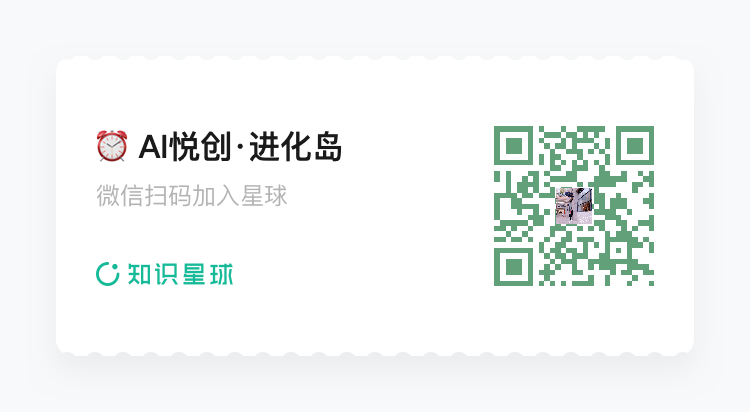

你好，我是悦创。

最近如平时那般，打开 ChatGPT 的设置相关页面查看剩余额度。

没想到，今天的这次查看有了意外之喜！—— ChatGPT  200 美刀的 API 额度不仅仅到账，还对 API 账号每日都有赠送 API 免费额度！

马上就去分享到我的交流群，有兴趣可以加入交流群，禁止发广告！（微信：Jiabcdefh，记得备注来意！）：

## 1. 200 美元的 Pro 领取 200 美元的 API 额度！

### 1.1 进到你的 ChatGPT 网页端【账单】

直接访问链接进去也可以：[https://chatgpt.com/settings/billing](https://chatgpt.com/settings/billing)

成功领取，去 API 平台查验！

### 1.2 API 平台查验

直接访问链接：[https://platform.openai.com/](https://platform.openai.com/)

还可以直接访问这个链接：[https://platform.openai.com/settings/organization/billing/overview](https://platform.openai.com/settings/organization/billing/overview)

恭喜到账！

## 2. 意外之喜（Plus、Pro 均有！）

经过我的验证，Plus 订阅用户也有这个福利！

推测，市面上的日租 Codex API key，有可能盈利之一就是白嫖免费额度！

### 2.1 快速了解

直接访问链接直达：[https://platform.openai.com/settings/organization/data-controls/sharing](https://platform.openai.com/settings/organization/data-controls/sharing)

我询问的 GPT 对话：[https://chatgpt.com/share/6aede226-6ae8-83ea-9916-a44c3f418727](https://chatgpt.com/share/6aede226-6ae8-83ea-9916-a44c3f418727)

可以把下面的截图，发给你的 AI。我就不过多解释，大意就是：

| 页面选项                                               | 中文解释                                                     | 你截图中的状态 |
| ------------------------------------------------------ | ------------------------------------------------------------ | -------------- |
| **Enable sharing of model feedback from the Platform** | **共享模型反馈**：允许组织成员在 Playground 测试模型时，点击回答的“踩”按钮，并选择将反馈和当前聊天内容提交给 OpenAI。 | 关闭           |
| **Share evaluation and fine-tuning data with OpenAI**  | **共享评估和微调数据**：包括用于评估、微调的提示词、模型回答、评分逻辑和结果。页面说明，只共享开启后创建的数据。 | 关闭           |
| **Share inputs and outputs with OpenAI**               | **共享 API 输入和输出**：允许 OpenAI 使用相关项目发送给模型的内容，以及模型生成的回答，来改进服务和训练模型。页面说明，只共享开启后发送的数据。 | 关闭           |

**绿色框中的每日免费额度，对应第三项「Share inputs and outputs with OpenAI」。** 如果你只是想参加这个免费用量计划，前两项可以继续保持关闭。

### 2.2 绿色框是什么意思？每天能免费用多少？

绿色提示的意思是：

> 你的账号有资格对“共享给 OpenAI 的 API 调用”享受每日免费用量。

| 额度分组 | 每日免费上限            | 截图列出的适用模型                                           |
| -------- | ----------------------- | ------------------------------------------------------------ |
| 第一组   | **100 万 tokens／天**   | `gpt-5.4`、`gpt-5.2`、`gpt-5.1`、`gpt-5`、`gpt-4.1`、`gpt-4o`、`o1`、`o3` |
| 第二组   | **1,000 万 tokens／天** | `gpt-5.4-mini`、`gpt-5.4-nano`、`gpt-5-mini`、`gpt-5-nano`、`gpt-4.1-mini`、`gpt-4.1-nano`、`gpt-4o-mini`、`o3-mini`、`o4-mini` |

**每一组内的模型共同使用该组额度。** 例如，第一组中，今天 `gpt-5.4` 用了 60 万 tokens，`gpt-4.1` 用了 30 万，那么第一组已经用了 90 万，还剩 10 万。

这里的 token 是模型处理内容的计量单位，不等于“调用次数”，也不能直接当成汉字数量。模型名单会更新，上表是在解释你这张截图。

### 2.3 免费用量有几个具体条件

- **输入和输出都计入用量**：你发给模型的内容、模型生成的回答都会消耗 tokens。
- **每天北京时间上午 8 点刷新**，对应 UTC 00:00。
- **只适用于已开启共享的项目及符合条件的模型调用**。
- **超额会收费**。官方特别说明：如果某一次请求会让当天累计用量超过限额，**这一整次请求会按正常价格收费**。
- 官方还要求账号有**正的可用余额**；工具使用、微调训练、微调模型和评估等费用不包含在这项每日免费 token 优惠内。

## 3. API 怎么用？

想必你也有群友的想法，我来跟你一次性分享一下 API 用途！

### 3.1 赚钱

Codex Pro 送的 200 美刀，如果你不知道用在哪里。你可以去卖额度，创建不同的 API、有效期、限额等。给那些要用 Codex 的用户，可以直接使用 API key 进行登录！

当然，还可以直接卖给项目需要用到 API key 的。

### 3.2 项目使用

如果你自己有开发项目，项目需要接入 AI 的话。这个赠送的 API 额度，也是可以直接使用的。

例如我的项目：[https://muse.brclio.com/](https://muse.brclio.com/)，需要用到 AI 的 API。此时就可以接入 OpenAI，但是有一个注意点！

如果你的部署环境没有梯子，则无法正常使用这个 API。（除非你的部署服务器、平台在海外，就可以直接使用！）

### 3.3 自己没额度的时候，使用 API key 登录 Codex 来继续任务

就是标题的含义！

### 3.4 等你补充！

……

::: details 公众号：AI悦创【二维码】

:::

::: info AI悦创·编程一对一

AI悦创·推出辅导班啦，包括「Python 语言辅导班、C++ 辅导班、java 辅导班、算法/数据结构辅导班、少儿编程、pygame 游戏开发、Web、Linux」，招收学员面向国内外，国外占 80%。全部都是一对一教学：一对一辅导 + 一对一答疑 + 布置作业 + 项目实践等。当然，还有线下线上摄影课程、Photoshop、Premiere 一对一教学、QQ、微信在线，随时响应！微信：Jiabcdefh

C++ 信息奥赛题解，长期更新！长期招收一对一中小学信息奥赛集训，莆田、厦门地区有机会线下上门，其他地区线上。微信：Jiabcdefh

方法一：[QQ](http://wpa.qq.com/msgrd?v=3&uin=1432803776&site=qq&menu=yes)

方法二：微信：Jiabcdefh

:::

